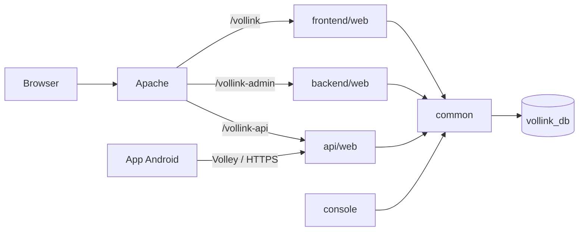

# Arquitetura

O VolLink segue o template **Yii2 Advanced** e acrescenta uma aplicação **`api` REST** e um cliente **Android**.



## Aplicações

| Pasta | Aplicação | Responsabilidade | Estado |
|---|---|---|---|
| `frontend/` | Front-office | Site público, área autenticada, eventos, candidaturas e presenças | ⏳ |
| `backend/` | Back-office | Moderação, gestão de utilizadores e validação de empresas | ⏳ |
| `api/` | API REST | Endpoints JSON consumidos pela app Android | ⏳ planeada |
| `console/` | Consola | Migrações, comandos RBAC e tarefas agendadas | ✅ |
| `common/` | Código partilhado | Modelos, configuração, RBAC e componentes | ✅ |
| `environments/` | Templates | Ficheiros `*-local.php` para `dev` e `prod` | ✅ |
| `android/` | App Android | Cliente do voluntário (Volley, SQLite, SharedPreferences) | ⏳ planeada |

!!! note "Apenas um backend"
    A API não é um serviço separado: é uma aplicação Yii2 dentro do mesmo repositório, que partilha `common/models`, `common/config` e o RBAC. Isto evita duplicar modelos e regras de negócio.

## Estrutura de pastas

```text
VolLink_Web/
├── api/
│   ├── config/            Configuração da API REST
│   ├── controllers/       Controladores REST
│   └── web/               Document root (alias /vollink-api)
├── backend/
│   ├── config/
│   ├── controllers/
│   ├── views/
│   └── web/               Document root (alias /vollink-admin)
├── common/
│   ├── config/
│   ├── models/            Modelos ActiveRecord
│   └── rbac/              Regras de autorização (EventOwnerRule)
├── console/
│   ├── controllers/       Comandos (rbac/init, rbac/assign, ...)
│   └── migrations/        Migrações da base de dados
├── environments/
└── frontend/
    ├── config/
    ├── controllers/
    ├── views/
    └── web/               Document root (alias /vollink)
```

A app Android fica no repositório do projeto (ou num repositório próprio, com os docentes adicionados), em `android/`.

## Fluxo de um pedido web

1. O browser pede, por exemplo, `/vollink/event/view?id=12`.
2. O Apache resolve o alias `/vollink` para `frontend/web`.
3. O `.htaccess` reescreve o pedido para `index.php` (URLs amigáveis).
4. O Yii2 resolve a rota `event/view` para `frontend\controllers\EventController::actionView()`.
5. O controlador consulta os modelos em `common\models`.
6. A vista é renderizada com o layout do front-office.

## Fluxo de um pedido Android

1. A app lê `server_url` e `token` de **SharedPreferences**.
2. O Volley envia, por exemplo, `GET {server_url}/events` com `Authorization: Bearer <token>`.
3. A API resolve a rota para `api\controllers\EventController::actionIndex()`.
4. O controlador consulta `common\models\Event` e devolve JSON.
5. A app guarda a lista em **SQLite** para consulta rápida/offline.
6. Se a API devolver `401`, a app limpa o token e volta ao login.

## URLs

| Aplicação | Alias | Exemplo |
|---|---|---|
| Front-office | `/vollink` | `http://localhost/vollink/event/view?id=12` |
| Back-office | `/vollink-admin` | `http://localhost/vollink-admin/user/index` |
| API | `/vollink-api` | `http://localhost/vollink-api/events` |

O alias do backend tem de ser declarado **antes** do alias do frontend no `httpd.conf`, porque `/vollink` é prefixo de `/vollink-admin`. O alias da API também deve ser declarado antes de `/vollink` se for `/vollink-api`.

## Autenticação da API

- `POST /api/auth/login` valida email/palavra-passe e devolve o **token** (`user.auth_key`) e o perfil.
- A app envia `Authorization: Bearer <token>` em todos os pedidos autenticados.
- O endpoint de login é público; o feed e o detalhe do evento podem ser públicos; candidaturas, perfil e notificações exigem token.
- A API usa HTTPS em produção (RNF-08).

## Diagrama de classes


## Decisões técnicas

### Tabela `user` intocada

A tabela `user` é a do template Yii2 e não é alterada. Todos os dados adicionais do perfil vivem em `user_details`, numa relação **1:1** (`user_details.user_id` é `UNIQUE`).

### Nomes em inglês

Tabelas, colunas e código usam **inglês** e `snake_case` (`event`, `application_deadline`, `confirmed_by_id`). Os textos da interface são em português.

### Sem `ENUM` do MySQL

Os estados são guardados em colunas `VARCHAR` e definidos como **constantes PHP** nos modelos. Adicionar um estado novo não exige uma migração — basta acrescentar a constante.

```php
public const STATUS_DRAFT = 'DRAFT';
public const STATUS_PUBLISHED = 'PUBLISHED';
```

### Credenciais fora do Git

As credenciais da base de dados existem apenas em `common/config/main-local.php`, que está no `.gitignore`. Os templates em `environments/` têm valores neutros.

### RBAC na base de dados

O `authManager` usa `yii\rbac\DbManager`. Roles, permissões e regras ficam nas tabelas `auth_*`, geridas pelo comando `php yii rbac/init`. Ver [Permissões](permissoes.md).

### API no mesmo repositório

A API é uma aplicação Yii2 (`api/`) que partilha os modelos e o RBAC de `common/`. Não há duplicação de regras de negócio e o Android consome os mesmos dados do website.

### Android só para voluntários

A app Android cobre o percurso do voluntário. Não implementa criação de eventos, gestão de turnos, decisões de candidaturas nem back-office. O âmbito técnico do AMSI está em [Funcionalidades Android](funcionalidades-android.md).

### Modelo A: empresa organiza, voluntário participa

Só a **empresa** cria e gere eventos. O voluntário candidata-se, acompanha horas e usa a app Android. O **coordenador do evento** é o utilizador da empresa que criou o evento (`event.creator_id`), não uma role RBAC. A empresa tem perfil público e dashboard de impacto; o voluntário tem perfil pessoal e histórico.

### `accessMobile` no MVP

A permissão `accessMobile` existe para a API. No MVP deve ser atribuída apenas ao role `voluntario`; o código atual ainda a liga a `sysAdmin` e `empresa` e será ajustado na fase da API. Ver [Permissões](permissoes.md).
