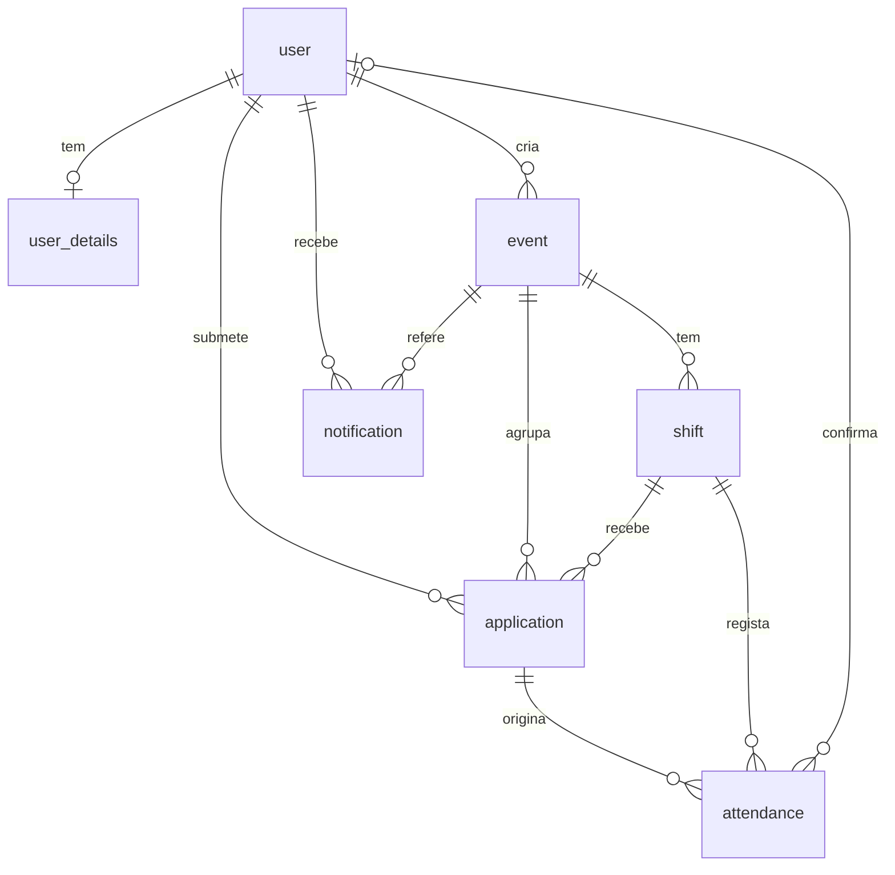

# Base de dados

Base de dados: **`vollink_db`** (MySQL / MariaDB, `utf8mb4`).

## Convenções

- Nomes em **inglês** e `snake_case`
- Chaves primárias `id` (`INT UNSIGNED AUTO_INCREMENT`)
- Timestamps `created_at` / `updated_at` (`INT`, Unix timestamp)
- Chaves estrangeiras com nome `fk-<tabela>-<coluna>`
- Índices únicos com nome `uq-<tabela>-<colunas>`
- Sem `ENUM` do MySQL: estados em `VARCHAR` + constantes PHP
- Motor InnoDB (suporta chaves estrangeiras e transações)

## Diagrama entidade-relação

## Tabelas

### `user`

Conta de autenticação — tabela do template Yii2, **não alterada**.

| Coluna | Tipo | Notas |
|---|---|---|
| `id` | INT PK | |
| `username` | VARCHAR(255) | `UNIQUE`, `NOT NULL` |
| `auth_key` | VARCHAR(32) | `NOT NULL` |
| `password_hash` | VARCHAR(255) | `NOT NULL` |
| `password_reset_token` | VARCHAR(255) | `UNIQUE`, nullable |
| `email` | VARCHAR(255) | `UNIQUE`, `NOT NULL` |
| `status` | SMALLINT | `10` ativo, `9` inativo, `0` eliminado |
| `created_at` | INT | |
| `updated_at` | INT | |
| `verification_token` | VARCHAR(255) | `UNIQUE`, nullable |

### `user_details`

Perfil e estado de aprovação, numa relação **1:1** com `user`.

| Coluna | Tipo | Notas |
|---|---|---|
| `id` | INT PK | |
| `user_id` | INT | `UNIQUE`, FK → `user.id` (`CASCADE`) |
| `name` | VARCHAR(100) | `NOT NULL` |
| `account_type` | VARCHAR(15) | `VOLUNTEER` (default), `COMPANY`, `ADMIN` |
| `birth_date` | DATE | nullable |
| `skills` | VARCHAR(255) | nullable |
| `description` | VARCHAR(500) | nullable — descrição pública da empresa |
| `website` | VARCHAR(255) | nullable — website da empresa |
| `location` | VARCHAR(150) | nullable — localização da empresa |
| `email_verified` | BOOLEAN | default `false` |
| `account_status` | VARCHAR(15) | `PENDING` (default), `APPROVED`, `REJECTED`, `SUSPENDED` |
| `rejection_reason` | VARCHAR(255) | nullable |
| `suspended_until` | DATETIME | nullable — fim da suspensão |
| `suspension_reason` | VARCHAR(255) | nullable — motivo da suspensão |
| `last_login_at` | DATETIME | nullable — último login |
| `created_at` | INT | |
| `updated_at` | INT | |

#### Estado do utilizador

O estado de autenticação e o estado de aprovação são conceitos diferentes:

| Situação | `user.status` | `user_details.account_status` | Consegue entrar? |
|---|---|---|---|
| Voluntário após confirmar email | `10` | `APPROVED` | ✅ |
| Voluntário antes de confirmar email | `9` | `PENDING` | ❌ |
| Empresa à espera do SysAdmin | `9` | `PENDING` | ❌ |
| Empresa aprovada | `10` | `APPROVED` | ✅ |
| Empresa rejeitada | `9` | `REJECTED` | ❌ |
| Utilizador suspenso | `9` | `SUSPENDED` | ❌ até `suspended_until` |
| Conta desativada | `9` | `APPROVED`/`SUSPENDED` | ❌ |
| Conta eliminada/anonimizada | `0` | `REJECTED` | ❌ |

!!! warning "Login de empresa"
    O login tem de validar **`user.status` e `user_details.account_status`**. Se apenas validar `user.status = 10`, uma empresa `PENDING` consegue entrar antes da aprovação.

### `event`

Evento de voluntariado.

| Coluna | Tipo | Notas |
|---|---|---|
| `id` | INT PK | |
| `creator_id` | INT | FK → `user.id` (`RESTRICT`) |
| `title` | VARCHAR(150) | `NOT NULL` |
| `description` | TEXT | `NOT NULL` |
| `category` | VARCHAR(50) | `NOT NULL` |
| `location` | VARCHAR(150) | `NOT NULL` |
| `required_skills` | VARCHAR(255) | nullable |
| `start_time` | DATETIME | `NOT NULL` |
| `end_time` | DATETIME | `NOT NULL` |
| `application_deadline` | DATETIME | `NOT NULL` |
| `capacity` | INT | `NOT NULL` |
| `status` | VARCHAR(15) | `DRAFT` (default), `PUBLISHED`, `CANCELLED`, `COMPLETED`, `ARCHIVED` |
| `created_at` | INT | |
| `updated_at` | INT | |

!!! note "`RESTRICT` no criador"
    Não é possível apagar um utilizador que tenha criado eventos. Os eventos têm de ser removidos ou transferidos primeiro.

!!! info "Modelo A"
    No Modelo A, `event.creator_id` aponta sempre para um utilizador com `user_details.account_type = COMPANY`. O voluntário não cria eventos.

### `shift`

Turno de um evento.

| Coluna | Tipo | Notas |
|---|---|---|
| `id` | INT PK | |
| `event_id` | INT | FK → `event.id` (`CASCADE`) |
| `name` | VARCHAR(50) | nullable — etiqueta do turno (ex.: “Turno da manhã”) |
| `start_time` | DATETIME | `NOT NULL` |
| `end_time` | DATETIME | `NOT NULL` |
| `capacity` | INT | `NOT NULL` — vagas do turno |
| `created_at` | INT | |
| `updated_at` | INT | |

!!! info "`shift.capacity`"
    Implementada na migração `m261024_130000_add_core_columns` (`NOT NULL`, default `1`).

### `application`

Candidatura de um voluntário a um **turno**.

| Coluna | Tipo | Notas |
|---|---|---|
| `id` | INT PK | |
| `user_id` | INT | FK → `user.id` (`CASCADE`) |
| `event_id` | INT | FK → `event.id` (`CASCADE`) — mantido para consultas |
| `shift_id` | INT | FK → `shift.id` (`CASCADE`) |
| `submitted_at` | DATETIME | `NOT NULL` |
| `status` | VARCHAR(15) | `PENDING` (default), `APPROVED`, `REJECTED`, `WITHDRAWN` |
| `created_at` | INT | |
| `updated_at` | INT | |

O índice `uq-application-user-shift (user_id, shift_id)` impede candidaturas duplicadas ao mesmo turno. O índice antigo `uq-application-user-event` foi removido: o voluntário pode candidatar-se a mais do que um turno do mesmo evento.

!!! info "Candidatura ao turno"
    A candidatura é **ao turno**; o `event_id` é mantido para consultas e relatórios. O modelo deve garantir que `shift.event_id = application.event_id`.

### `attendance`

Presença num turno, com as horas realizadas.

| Coluna | Tipo | Notas |
|---|---|---|
| `id` | INT PK | |
| `application_id` | INT | FK → `application.id` (`CASCADE`) |
| `shift_id` | INT | FK → `shift.id` (`CASCADE`) |
| `hours_worked` | DECIMAL(5,2) | default `0` |
| `confirmed` | BOOLEAN | default `false` |
| `confirmed_by_id` | INT | FK → `user.id` (`SET NULL`) |
| `confirmed_at` | DATETIME | nullable |
| `created_at` | INT | |
| `updated_at` | INT | |

O índice `uq-attendance-application-shift (application_id, shift_id)` impede registos duplicados. O `shift_id` da presença deve ser o mesmo da candidatura (`application.shift_id`).

!!! info "Quem regista as horas"
    No MVP, é o **coordenador** que regista `hours_worked` e confirma a presença. Não há check-in/check-out nem colunas `check_in_at`/`check_out_at`.

### `notification`

Notificação de um utilizador, opcionalmente ligada a um evento.

| Coluna | Tipo | Notas |
|---|---|---|
| `id` | INT PK | |
| `user_id` | INT | FK → `user.id` (`CASCADE`) |
| `event_id` | INT | FK → `event.id` (`SET NULL`), nullable |
| `type` | VARCHAR(40) | `NOT NULL` (ex.: `NEW_EVENT`, `APPLICATION_APPROVED`) |
| `message` | VARCHAR(500) | `NOT NULL` |
| `scheduled_at` | DATETIME | `NOT NULL` |
| `sent_at` | DATETIME | nullable |
| `read_at` | DATETIME | nullable — `NULL` = não lida |
| `status` | VARCHAR(15) | `PENDING` (default), `SENT`, `FAILED` |
| `created_at` | INT | |
| `updated_at` | INT | |

### Tabelas de RBAC

Criadas e geridas pelo `yii\rbac\DbManager`:

| Tabela | Conteúdo |
|---|---|
| `auth_item` | Roles e permissões |
| `auth_item_child` | Herança entre roles/permissões |
| `auth_assignment` | Roles atribuídos a utilizadores |
| `auth_rule` | Regras PHP (ex.: `eventOwner`) |

### `migration`

Histórico das migrações aplicadas, gerido pelo Yii2.

## Resumo das chaves estrangeiras

| Chave | Tabela | Coluna | Referência | ON DELETE |
|---|---|---|---|---|
| `fk-user_details-user_id` | `user_details` | `user_id` | `user.id` | CASCADE |
| `fk-event-creator_id` | `event` | `creator_id` | `user.id` | RESTRICT |
| `fk-shift-event_id` | `shift` | `event_id` | `event.id` | CASCADE |
| `fk-application-user_id` | `application` | `user_id` | `user.id` | CASCADE |
| `fk-application-event_id` | `application` | `event_id` | `event.id` | CASCADE |
| `fk-application-shift_id` | `application` | `shift_id` | `shift.id` | CASCADE |
| `fk-attendance-application_id` | `attendance` | `application_id` | `application.id` | CASCADE |
| `fk-attendance-shift_id` | `attendance` | `shift_id` | `shift.id` | CASCADE |
| `fk-attendance-confirmed_by_id` | `attendance` | `confirmed_by_id` | `user.id` | SET NULL |
| `fk-notification-user_id` | `notification` | `user_id` | `user.id` | CASCADE |
| `fk-notification-event_id` | `notification` | `event_id` | `event.id` | SET NULL |

## Colunas do núcleo (Modelo A)

A migração `m261024_130000_add_core_columns` acrescenta as seis colunas do MVP:

| Objeto | Objetivo |
|---|---|
| `shift.capacity` | Vagas por turno (`NOT NULL`, default `1`) |
| `user_details.suspended_until` | Fim da suspensão |
| `user_details.last_login_at` | Último login (back-office) |
| `user_details.description` | Descrição pública da empresa |
| `user_details.website` | Website da empresa |
| `user_details.location` | Localização da empresa |

## Colunas de UI

A migração `m261024_160000_add_ui_columns` acrescenta:

| Objeto | Objetivo |
|---|---|
| `shift.name` | Etiqueta do turno (ex.: “Turno da manhã”) |
| `user_details.suspension_reason` | Motivo da suspensão |
| `notification.read_at` | Estado lido/não lido (`NULL` = não lida) |

## Fase 2 (fora do âmbito)

Tabelas e colunas que existiam na versão inicial e ficam para fase 2:

| Objeto | Objetivo |
|---|---|
| `saved_event` | Eventos guardados/favoritos por um voluntário |
| `event_review` | Avaliações e reputação |
| `report` | Denúncias de eventos, utilizadores ou conteúdos |
| `category` | Categorias geríveis pelo SysAdmin |
| `admin_log` | Registo de ações administrativas |
| `attendance.check_in_at` / `check_out_at` | Check-in/check-out na app |
| `user_details.photo`, `biography` | Perfil alargado do voluntário (a localização já existe para empresas) |
| `user_details.reputation` | Reputação do organizador |
| `user_details.failed_login_attempts`, `locked_until` | Bloqueio após tentativas falhadas |
| `user_details.notify_new_events` | Preferência de notificações de novos eventos |

## Migrações

- **11 migrações do projeto** (8 anteriores + `add_core_columns` + `application_shift_level` + `add_ui_columns`).
- **4 migrações do RBAC** (`@yii/rbac/migrations`).
- **16 registos** na tabela `migration`: 11 do projeto + 4 do RBAC + `m000000_000000_base` (marcador do Yii).
- As colunas do Modelo A, a **candidatura por turno** e as **colunas de UI** já estão aplicadas; as migrações foram testadas com `up` e `down`.
