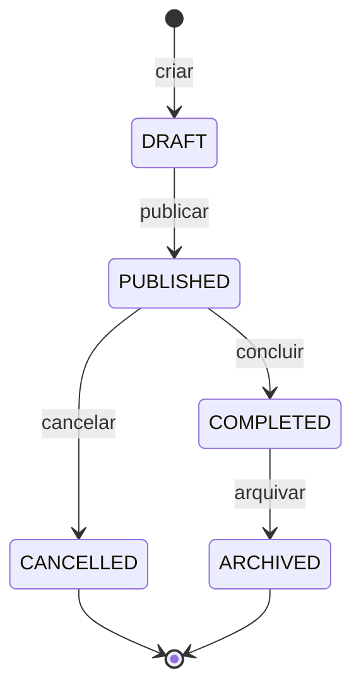
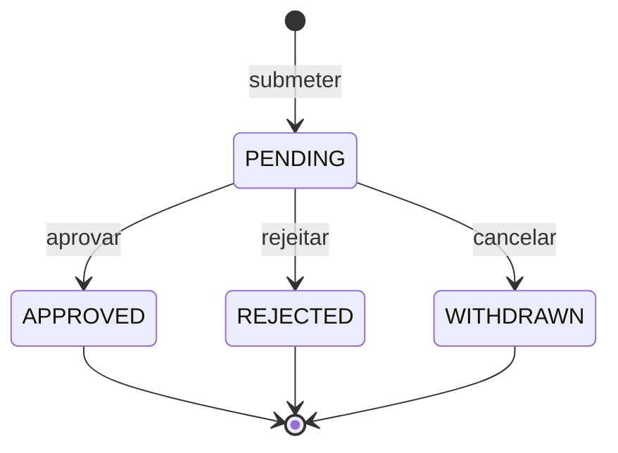

# Funcionalidades Web

O website do VolLink tem duas áreas:

- **Front-office** — visitantes, voluntários, empresas e coordenadores de evento.
- **Back-office** — apenas o `sysAdmin`.

## Roles

| Role | Onde atua | O que pode fazer |
|---|---|---|
| **Visitante** | Front-office | Consultar eventos publicados e detalhes. Pode registar-se. |
| **Voluntário** | Front-office | Gerir perfil, candidatar-se e cancelar candidaturas, consultar histórico/horas. **Não cria nem gere eventos.** |
| **Empresa** | Front-office | Criar e gerir eventos, decidir candidaturas, confirmar presenças, editar o perfil público e consultar o dashboard de impacto. Não se candidata. Conta validada pelo SysAdmin. |
| **Coordenador do evento** | Front-office | Perfil **derivado** do utilizador da empresa que criou o evento (`event.creator_id`). Gere apenas os seus eventos. Não é uma role RBAC. |
| **SysAdmin** | Back-office | Gerir utilizadores, validar empresas, moderar eventos e consultar estatísticas. Não cria eventos no front-office. |

## 1. Autenticação e conta

**Requisitos:** RF-FO-01, RF-FO-11, RF-FO-12, RF-FO-16.

- Registo com escolha do tipo de conta: **Voluntário** ou **Empresa**.
- Verificação de email antes da ativação.
- Login por **email (ou username)** e palavra-passe.
- Recuperação de palavra-passe por email.
- Alteração de palavra-passe com confirmação da atual.
- Logout.

**Regras de ativação**

| Tipo | Estado inicial | Quando fica ativo |
|---|---|---|
| Voluntário | `PENDING` + email por confirmar | Após confirmação do email |
| Empresa | `PENDING` | Após confirmação do email **e** aprovação do SysAdmin |
| Suspenso | `SUSPENDED` | Após o fim de `suspended_until` ou reativação pelo SysAdmin |

!!! warning "Login de empresa pendente"
    A empresa não pode autenticar-se antes da aprovação. O login tem de validar `user.status` **e** `user_details.account_status`; não basta `user.status = 10`. Ver [Base de dados](base-de-dados.md#estado-do-utilizador).

### Registo de conta de empresa (US10)

O registo está implementado em `frontend/models/SignupForm.php` e em `frontend/views/site/signup.php`.

**Fluxo**

1. O visitante escolhe o tipo de conta: **Voluntário** ou **Empresa**. O JavaScript em `frontend/web/js/site.js` mostra os campos do tipo escolhido.
2. **Empresa:** nome da empresa, email e palavra-passe são obrigatórios. **Voluntário:** nome, email e palavra-passe são obrigatórios.
3. O email é validado e tem de ser único (`user.email`).
4. São criados o `user` (status `9`) e o `user_details` com `account_type`, `account_status = PENDING` e `email_verified = false`. Se o perfil não for gravado, o `user` é removido.
5. O sistema envia o email de confirmação (`common/mail/emailVerify-html.php` e `emailVerify-text.php`).
6. Ao abrir o link, o `VerifyEmailForm` marca `email_verified = true`:
   - **Voluntário:** `user.status = 10` e `account_status = APPROVED`.
   - **Empresa:** continua `user.status = 9` e `account_status = PENDING`.
7. O login (`User::findByLogin`) aceita **email ou username** e exige `user.status = 10` **e** `user_details.account_status = APPROVED`, quando existe perfil. Uma empresa `PENDING` não entra.
8. A empresa só cria e publica eventos depois de o SysAdmin a aprovar (`account_status = APPROVED` e `user.status = 10`), porque a permissão `eventCreate` pertence ao role `empresa`.

**Campos e destino na base de dados**

| Campo no formulário | Destino |
|---|---|
| Nome (voluntário) | `user.username` e `user_details.name` |
| Nome da empresa | `user_details.name`; o `user.username` passa a ser o email |
| Email | `user.email` (único) |
| Palavra-passe | `user.password_hash` |
| Tipo de conta | `user_details.account_type` (`VOLUNTEER` ou `COMPANY`) |

!!! info "Sem migração nova"
    A tabela `user_details` já tinha `name`, `account_type`, `account_status` e `email_verified`. A US10 reutiliza essas colunas e não altera o esquema.

**Como validar manualmente**

1. Registar uma empresa em `/site/signup` com o tipo de conta **Empresa**.
2. Confirmar o email através do link gerado em `common/config/main-local.php` (`useFileTransport = true` guarda o email em `frontend/runtime/mail`).
3. Tentar entrar: o login é recusado enquanto a conta estiver `PENDING`.
4. Aprovar a empresa: a validação no back-office é a US8 (ainda não implementada), por isso, para já, atualizar `user_details.account_status = 'APPROVED'` e `user.status = 10` na base de dados.
5. Voltar a entrar com o email e a palavra-passe.

## 2. Perfil

**Requisitos:** RF-FO-05, RF-FO-14.

- Consultar e editar: **nome**, **competências** e **data de nascimento**.
- Consultar histórico de participações e total de horas confirmadas.
- O voluntário vê apenas o seu próprio histórico.

## 3. Eventos e turnos

**Requisitos:** RF-FO-02, RF-FO-03, RF-FO-04, RF-FO-06, RF-FO-07, RF-FO-08, RF-FO-09.

### Feed e pesquisa

- Feed público de eventos `PUBLISHED`, ordenado por data de início, com paginação.
- Pesquisa por texto e filtros por **categoria**, **localização** e **intervalo de datas**.
- Detalhe do evento: descrição, categoria, localização, competências, turnos, vagas e organizador.

!!! success "US1 implementada (web)"
    O feed e o detalhe público já estão ligados aos modelos:

    - `SiteController::actionIndex` usa `Event::findPublished()`, filtra por `q` (título/descrição), `category`, `location`, `date_from` e `date_to`, e pagina os resultados.
    - `EventController::actionView` só devolve eventos `PUBLISHED`; um evento `DRAFT` ou inexistente responde `404`.
    - As vagas são calculadas: `capacity - candidaturas APPROVED`, tanto no evento como em cada turno (`Event::getAvailableSeats()` e `Shift::getAvailableSeats()`).
    - O detalhe mostra descrição, requisitos (`required_skills`), turnos, vagas e o nome/estado de verificação da empresa.

    Testes: `frontend/tests/Functional/EventFeedCest.php` cobre lista sem autenticação, pesquisa, os três filtros, detalhe e `404` para rascunhos.

!!! warning "Android"
    A app Android ainda não existe no repositório e o módulo `api/` está planeado (ver [Roadmap](roadmap.md)). O endpoint `GET /api/events` deve reutilizar `Event::findPublished()` para devolver a mesma lista depois da autenticação.

### Criar e gerir

- A **empresa** cria eventos; o utilizador da empresa que cria o evento torna-se **coordenador do evento**.
- O **voluntário não cria eventos**; apenas se candidata aos eventos das empresas.
- O evento nasce em `DRAFT`.
- O coordenador pode editar enquanto estiver em `DRAFT` ou `PUBLISHED`.
- O coordenador pode publicar, cancelar, concluir ou arquivar o seu evento.
- O SysAdmin pode cancelar ou arquivar qualquer evento (`moderateEvent`), mas não o edita.

### Estados do evento

| Estado | Visível ao público | Recebe candidaturas |
|---|:---:|:---:|
| `DRAFT` | ❌ | ❌ |
| `PUBLISHED` | ✅ | ✅ até ao prazo |
| `CANCELLED` | ✅ como cancelado | ❌ |
| `COMPLETED` | ✅ | ❌ |
| `ARCHIVED` | ❌ | ❌ |

### Turnos

- Um evento pode ter vários turnos.
- Cada turno tem **nome** (opcional), início, fim e **vagas** (`shift.capacity`).
- O turno tem de estar dentro das datas do evento.
- Não é possível remover um turno que já tenha presenças.
- As presenças são registadas **por turno**.

## 4. Candidaturas

**Requisitos:** RF-FO-08, RF-FO-13, RF-FO-15.

- Só o **voluntário** se candidata; a empresa não.
- A candidatura é **a um turno**. O voluntário escolhe um turno disponível e pode candidatar-se a mais do que um turno do mesmo evento.
- Não são permitidas candidaturas duplicadas ao mesmo turno.
- O sistema bloqueia candidaturas quando:
  - o evento não está `PUBLISHED`;
  - o prazo (`application_deadline`) passou;
  - a capacidade do turno (`shift.capacity`) ou do evento (`event.capacity`) está esgotada.
- O coordenador consulta candidatos **por turno** e aprova ou rejeita.
- A aprovação é validada em transação: as aprovadas por turno não podem exceder `shift.capacity` e o total do evento não pode exceder `event.capacity`.
- O voluntário pode cancelar até ao início do turno.

!!! tip "Vagas calculadas, não guardadas"
    As vagas do turno são `shift.capacity - candidaturas aprovadas no turno`; as do evento são `event.capacity - total de aprovadas`. Tudo é calculado na transação de aprovação, sem contadores guardados.

## 5. Presenças e horas

**Requisitos:** RF-FO-10, RF-FO-14.

1. A candidatura é aprovada.
2. O voluntário comparece no turno.
3. O coordenador regista as horas realizadas nesse turno.
4. O coordenador confirma a presença (`confirmed = true`, `confirmed_by_id`, `confirmed_at`).
5. O total de horas do voluntário é atualizado a partir das presenças confirmadas.

- O coordenador só pode registar presenças nos eventos que criou.
- O coordenador pode corrigir as horas antes ou depois da confirmação.
- As horas são registadas pelo coordenador.

## 6. Relatório do evento

**Requisito:** RF-FO-17.

- O coordenador consulta um resumo dos seus eventos:
  - número de candidaturas;
  - número de aprovações;
  - presenças confirmadas;
  - total de horas.
- Pode filtrar por evento e por período.

## 7. Notificações

- Notificações **in-app** (tabela `notification`), com estado lido/não lido (`read_at`).
- Email para eventos-chave (verificação de conta, decisão de candidatura, recuperação de palavra-passe).

| Tipo | Quando é gerada |
|---|---|
| `APPLICATION_SUBMITTED` | O voluntário submete uma candidatura |
| `APPLICATION_APPROVED` | O coordenador aprova |
| `APPLICATION_REJECTED` | O coordenador rejeita |
| `APPLICATION_WITHDRAWN` | O voluntário cancela |
| `EVENT_CANCELLED` | O evento é cancelado |
| `EVENT_REMINDER` | 24 horas antes do turno |

## 8. Perfil público da empresa

**Requisitos:** RF-FO-19, RF-FO-20.

- Cada empresa tem uma página pública com:
  - nome da organização;
  - descrição;
  - localização;
  - website;
  - selo **Verificada** quando `account_status = APPROVED`;
  - lista de eventos publicados.
- A empresa edita o perfil na sua área.
- O perfil é visível para visitantes, voluntários e SysAdmin.
- O voluntário chega ao perfil a partir do organizador no detalhe do evento.

## 9. Dashboard da empresa

**Requisito:** RF-FO-18.

- A empresa vê apenas os seus dados:
  - eventos ativos e concluídos;
  - candidaturas pendentes;
  - voluntários recrutados;
  - total de horas geradas;
  - taxa de aprovação das candidaturas.
- Os dados são calculados a partir de `event`, `application` e `attendance`; não há tabela de dashboard.

## 10. Back-office

**Requisitos:** RF-BO-01, RF-BO-02, RF-BO-03, RF-BO-04, RF-BO-05, RF-BO-06.

| Área | Ações | Permissão |
|---|---|---|
| Dashboard | Contagens de utilizadores, eventos, candidaturas e horas | `accessBackoffice` |
| Eventos | Consultar, cancelar ou arquivar qualquer evento | `moderateEvent` |
| Utilizadores | Criar, editar, ativar, suspender com motivo e duração, e desativar; ver último login | `userModerate` |
| Empresas | Validar ou rejeitar contas, com motivo | `userModerate` |

!!! info "Permissões reservadas"
    `contentModerate` e `systemManage` existem no RBAC, mas não são usadas por nenhum controlador. O `accessMobile` é usado apenas pelo voluntário na app Android.

## Estado de implementação

| Funcionalidade | Estado |
|---|---|
| Esqueleto Yii2 Advanced | ✅ |
| Migrações do domínio | ✅ |
| RBAC (3 roles, 12 permissões, `eventOwner`) | ✅ |
| URLs amigáveis | ⏳ |
| Modelos ActiveRecord (`User`, `UserDetails`, `Event`, `Shift`, `Application`, `Attendance`, `Notification`) | ✅ |
| Registo de conta de empresa (US10) | ✅ |
| Feed público e detalhe de eventos (US1) | ✅ |
| Pesquisa e filtros por categoria, localização e datas | ✅ |
| Verificação de email | ✅ |
| Login por email ou username | ✅ |
| Perfil | ⏳ |
| CRUD de eventos e turnos | ⏳ |
| Candidaturas | ⏳ |
| Presenças e horas | ⏳ |
| Notificações | ⏳ |
| Relatório do evento | ⏳ |
| Perfil público da empresa | ⏳ |
| Dashboard da empresa | ⏳ |
| Back-office | ⏳ |

Ver [Requisitos](requisitos.md), [User Stories](user-stories.md) e [Roadmap](roadmap.md).
